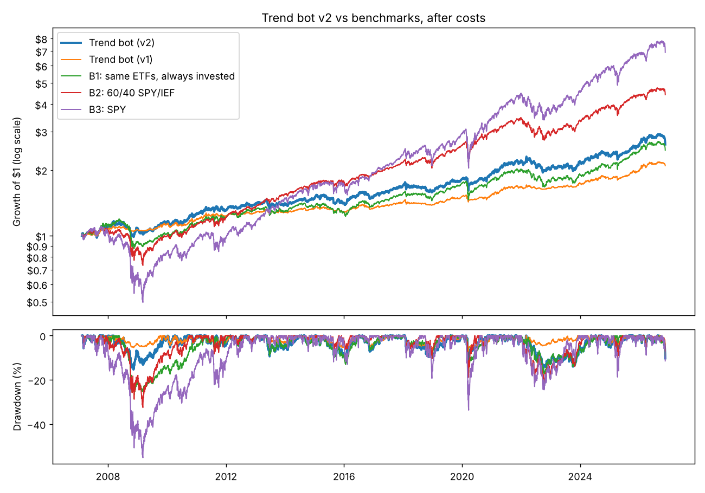

# Trend Bot

A paper-trading bot that follows price trends across nine ETFs. It holds an ETF only while that ETF's trend beats the return on Treasury bills, sizes positions against a 10% yearly volatility limit, and never shorts or borrows. Orders go to an Alpaca paper account, which uses simulated money and real market prices.

Built by Miles Atkinson. The rules were written down in a spec before any backtest results existed, and every backtest run gets a row in `trials.csv`, so the results can be checked for overfitting.

## Status

| Dates | Work | State |
| --- | --- | --- |
| Nov 23 to 29, 2026 | Trading rules and data loader | Done |
| Nov 30 to Dec 6 | Backtest, benchmarks and validation | Done (both versions passed) |
| Dec 7 to 13 | Live bot in dry-run mode, spec locked | Not started |
| Dec 14 | Live paper trading starts | Not started |

## Backtest

Two versions of the sizing rule were written into the spec before each was tested. Version 1 treats 10% volatility as a ceiling. Version 2 treats it as a target, adding risk up to 25% per ETF and 100% invested. Both use the same signals and were tested from February 2007 to November 2026 with a 5 basis point cost on every trade.

| Portfolio | Annual return | Volatility | Sharpe | Max drawdown | Worst year |
| --- | --- | --- | --- | --- | --- |
| Version 1 | 3.8% | 5.1% | 0.46 | -7.2% | -2.9% |
| Version 2 | 5.0% | 8.1% | 0.45 | -15.5% | -8.8% |
| Same ETFs, always invested | 4.7% | 8.9% | 0.38 | -26.8% | -16.6% |
| 60% SPY / 40% IEF | 7.8% | 11.0% | 0.60 | -32.5% | -17.9% |
| SPY | 10.3% | 19.6% | 0.52 | -55.2% | -36.8% |

Both versions cleared the three bars set in the spec: a higher Sharpe ratio than the always-invested version, a smaller maximum drawdown, and a deflated Sharpe ratio of at least 0.95 (0.955 for version 1, 0.952 for version 2, counting all seven trials). Neither earned as much as SPY or a 60/40 portfolio.

Full results: [version 1](results/v1/summary.md), [version 2](results/v2/summary.md).

Version 3 is written into the spec and the code but has not been run yet. It keeps version 2's sizing and adds four ETFs (UUP for the US dollar, FXY for the yen, DBB for industrial metals and DBA for agriculture), based on a review of trend-following research. The reasons, the studies, and the ideas it leaves out are in [SPEC.md](SPEC.md#version-3-13-etfs). Version 4 is version 3 at 1.5 times the size, with exposure above 100% held through 2x funds; it is also in the spec and not yet run.

## The rules

1. The bot trades nine ETFs: SPY, EFA, EEM, VNQ, IEF, TLT, TIP, GLD and DBC. Together they cover US and foreign stocks, real estate, Treasuries, gold and commodities.
2. For lookbacks of 21, 63, 126 and 252 trading days, it checks whether each ETF's total return beat T-bills over the same window. The trend score is the share of the four checks that pass: 0, 0.25, 0.5, 0.75 or 1.
3. Each ETF starts at 1/9 of the portfolio. If the equal-weight mix has run above 10% yearly volatility over the last 126 days, all nine shrink by the same factor. Each weight is then multiplied by its trend score, and the rest stays in cash. Version 2 instead scales the weights up or down to 10% expected volatility, with at most 25% in any ETF and at most 100% invested. Version 3 uses the version 2 sizing on 13 ETFs; each new ETF joins once it has a year of prices.
4. It trades once a week. An ETF trades when its trend score has changed since its last trade, or when its weight has drifted more than 2 percentage points from target.

The full rules are in [SPEC.md](SPEC.md).

## Files

| File | What it does |
| --- | --- |
| `SPEC.md` | The strategy spec, committed before any backtest results |
| `strategy.py` | The trading rules, shared by the backtest and the live bot |
| `backtest.py` | Runs a spec version with its benchmarks and variants over 2007 to 2026 (`python backtest.py 2`) and writes `results/v1/` or `results/v2/` |
| `results/` | Summary, daily equity, every trade, every position from entry to exit, and the chart |
| `tests/` | Fail if any rule uses future prices, if the portfolio shorts or borrows, if the backtest's dollars don't reconcile, or if version 3 holds an ETF before it has a year of prices |
| `tools/two_x_costs.py` | Measures what each 2x fund costs per year beyond twice its 1x ETF (used by version 4) |
| `trials.csv` | One row per backtest run, used for the deflated Sharpe ratio |

## Data

Prices come from Yahoo Finance through the `yfinance` library, adjusted for splits and dividends. The T-bill yield is Yahoo's `^IRX` series. Trades go through Alpaca's paper trading API.

Paper trading only. Nothing here is investment advice.
