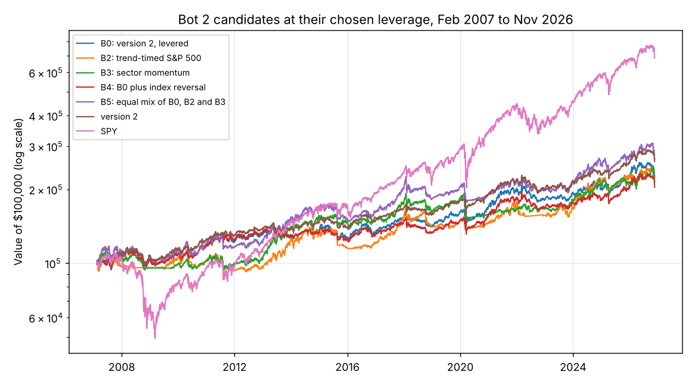

# Bot 2 candidates: results

Rules: SPEC.md, "Bot 2: registered candidates", committed before this run. Period: 2007-02-12 to 2026-11-20. Each candidate starts with $100,000.

Leverage is chosen from 21 settings (1.0 to 3.0) using 10,000 ten-year stationary-bootstrap paths (mean block 2.9 days, seed 0), the same paths for every candidate.

## Ranking by the registered rule

| Rank | Candidate | Leverage | Median 10-year return | 10th percentile | Paths falling 25% | Deflated Sharpe | Passes |
| --- | --- | --- | --- | --- | --- | --- | --- |
| 1 | B5: equal mix of B0, B2 and B3 | 1.9 | 6.0% | 1.0% | 0.0% | 0.785 | no |
| 2 | B3: sector momentum | 1.3 | 4.9% | 0.4% | 0.0% | 0.686 | no |
| 3 | B2: trend-timed S&P 500 | 1.7 | 4.9% | 0.3% | 0.0% | 0.675 | no |
| 4 | B0: version 2, levered | 1.5 | 4.6% | 0.6% | 0.0% | 0.743 | no |
| 5 | B4: B0 plus index reversal | 1.4 | 4.0% | 0.4% | 0.0% | 0.685 | no |

Winner under the registered rules: **B0: version 2, levered** (B5: equal mix of B0, B2 and B3 ranked first but did not pass).

## Full backtest at the chosen leverage

| Portfolio | Ending value | Annual return | Volatility | Sharpe | Max drawdown | Worst year | Average exposure | Days below full leverage |
| --- | --- | --- | --- | --- | --- | --- | --- | --- |
| B0: version 2, levered | $224,613 | 4.2% | 9.9% | 0.31 | -16.8% | -10.1% (2022) | 109% | 96% |
| B2: trend-timed S&P 500 | $214,105 | 3.9% | 11.2% | 0.26 | -19.1% | -13.9% (2015) | 74% | 96% |
| B3: sector momentum | $215,175 | 4.0% | 10.8% | 0.27 | -22.0% | -13.9% (2020) | 66% | 96% |
| B4: B0 plus index reversal | $204,008 | 3.7% | 9.3% | 0.27 | -16.2% | -9.7% (2018) | 98% | 96% |
| B5: equal mix of B0, B2 and B3 | $263,813 | 5.0% | 12.1% | 0.34 | -21.5% | -9.7% (2022) | 104% | 95% |
| Version 2 (live bot, no leverage) | $259,331 | 4.9% | 8.1% | 0.44 | -15.5% | -8.8% (2022) | | |
| SPY | $686,599 | 10.2% | 19.6% | 0.52 | -55.2% | -36.8% (2008) | | |

Probability of backtest overfitting across the five (CSCV, 16 blocks): 0.88.
Hansen's SPA test of B5 against B0: p = 0.273 (below 0.05 would mean B5 beats B0 after allowing for luck).
The deflated Sharpe ratio counts all 16 trials; the best of 16 unskilled trials would be expected to reach an annual Sharpe ratio of about 0.16 by luck.

Notes: levered returns scale each base backtest's daily return above T-bills (SPEC.md, bot 2 rule 4). The extra 5 bp is charged on each change in the leverage multiplier c, times the invested share. Leverage is fitted on the same history it is tested on. Returns here count from the $100,000 start on Feb 12, 2007, so version 2 shows 4.9% a year and a 0.44 Sharpe ratio; the version tables, which count from the first close, show 5.0% and 0.45. tools/bot2_diagnostics.py writes diagnostics.md: the base rules without leverage, the cost of the floor rule, and longer bootstrap blocks.

