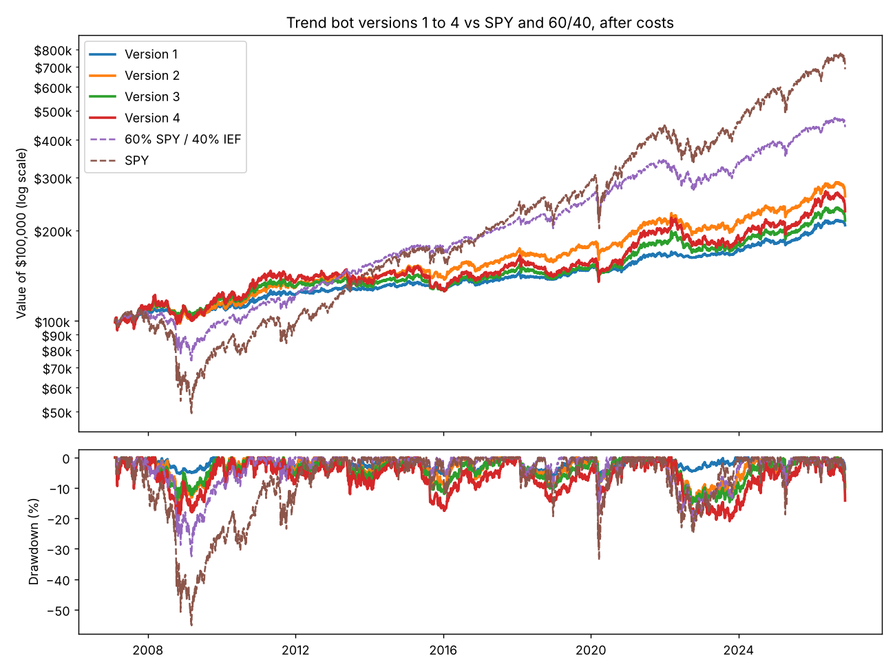

# Comparison: versions 1 to 4, SPY and 60/40

Each starts with $100,000 on 2007-02-12 and runs to 2026-11-20, after a 5 bp cost on every trade. Sharpe ratios are measured against T-bills.

| Portfolio | Ending value | Annual return | Volatility | Sharpe | Max drawdown | Worst year | Best year |
| --- | --- | --- | --- | --- | --- | --- | --- |
| Version 1 | $207,997 | 3.8% | 5.1% | 0.46 | -7.2% | -2.9% (2015) | 9.5% (2021) |
| Version 2 | $259,331 | 5.0% | 8.1% | 0.45 | -15.5% | -8.8% (2022) | 14.6% (2021) |
| Version 3 | $215,498 | 4.0% | 7.7% | 0.35 | -15.2% | -6.9% (2022) | 14.0% (2021) |
| Version 4 | $231,481 | 4.4% | 10.8% | 0.31 | -20.9% | -10.6% (2022) | 18.7% (2021) |
| 60% SPY / 40% IEF | $440,824 | 7.8% | 11.0% | 0.60 | -32.5% | -17.9% (2008) | 22.0% (2019) |
| SPY | $686,598 | 10.3% | 19.6% | 0.52 | -55.2% | -36.8% (2008) | 32.3% (2013) |

## Calendar-year returns

2007 starts on Feb 12 and 2026 ends on Nov 20.

| Year | Version 1 | Version 2 | Version 3 | Version 4 | 60% SPY / 40% IEF | SPY |
| --- | --- | --- | --- | --- | --- | --- |
| 2007 | 7.0% | 9.9% | 9.9% | 11.2% | 6.7% | 3.8% |
| 2008 | -0.3% | -1.2% | 2.7% | 1.8% | -17.9% | -36.8% |
| 2009 | 5.5% | 5.9% | 5.9% | 8.8% | 12.8% | 26.4% |
| 2010 | 6.2% | 9.9% | 10.3% | 13.5% | 13.5% | 15.1% |
| 2011 | 3.0% | 3.3% | -0.7% | -2.2% | 7.7% | 1.9% |
| 2012 | 3.7% | 7.0% | 3.7% | 4.8% | 11.2% | 16.0% |
| 2013 | 0.9% | 1.0% | -1.2% | -2.0% | 15.6% | 32.3% |
| 2014 | 3.2% | 4.6% | 2.6% | 2.9% | 11.8% | 13.5% |
| 2015 | -2.9% | -4.5% | -6.8% | -10.5% | 1.7% | 1.2% |
| 2016 | 3.4% | 6.7% | 6.4% | 8.2% | 7.7% | 12.0% |
| 2017 | 6.7% | 12.7% | 9.9% | 13.9% | 13.7% | 21.7% |
| 2018 | -2.8% | -5.8% | -6.8% | -9.9% | -2.0% | -4.6% |
| 2019 | 9.0% | 13.4% | 9.3% | 11.3% | 22.0% | 31.2% |
| 2020 | 2.0% | 6.5% | 6.7% | 8.4% | 16.4% | 18.3% |
| 2021 | 9.5% | 14.6% | 14.0% | 18.7% | 15.0% | 28.7% |
| 2022 | -2.2% | -8.8% | -6.9% | -10.6% | -16.6% | -18.2% |
| 2023 | 5.9% | 8.6% | 5.8% | 5.7% | 16.8% | 26.2% |
| 2024 | 4.3% | 6.1% | 6.9% | 7.5% | 14.1% | 24.9% |
| 2025 | 8.4% | 11.1% | 9.7% | 11.9% | 13.9% | 17.7% |
| 2026 | 6.1% | 1.4% | 1.1% | 0.5% | 0.9% | 1.9% |
