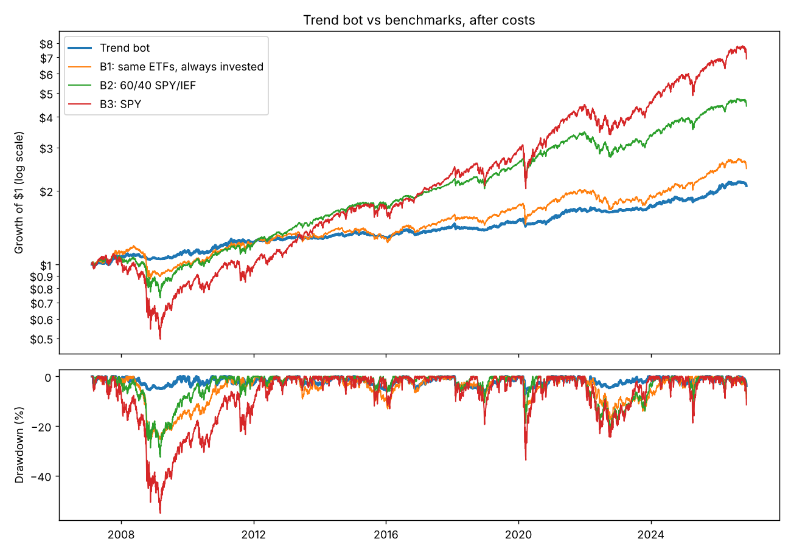

# Backtest results, spec v1

Run on 2026-11-22 23:32 ET with Yahoo Finance data downloaded at run time. Simulation from 2007-02-12 to 2026-11-20, starting at $100,000. Trades fill at the next day's open with a 5 bp cost; cash earns the 13-week T-bill rate.

**Result: PASS** on the three bars set in SPEC.md before this run.

| Bar | Result |
| --- | --- |
| Sharpe ratio beats B1 | 0.46 vs 0.38: yes |
| Max drawdown smaller than B1 | -7.2% vs -26.8%: yes |
| Deflated Sharpe ratio at least 0.95 | 0.955 (6 trials): yes |

## Full period

| Portfolio | Annual return | Annual volatility | Sharpe (vs T-bills) | Max drawdown | Worst calendar year | Turnover per year | Average invested |
| --- | --- | --- | --- | --- | --- | --- | --- |
| Trend bot | 3.8% | 5.1% | 0.46 | -7.2% | -2.9% (2015) | 539% | 56% |
| B1: same ETFs, always invested | 4.7% | 8.9% | 0.38 | -26.8% | -16.6% (2008) | 24% | 90% |
| B2: 60% SPY / 40% IEF | 7.8% | 11.0% | 0.60 | -32.5% | -17.9% (2008) | 23% | 100% |
| B3: SPY buy and hold | 10.3% | 19.6% | 0.52 | -55.2% | -36.8% (2008) | 2% | 100% |

First and last calendar years are partial (2007 starts in February, 2026 ends in November).

## Sub-periods

| Period | Portfolio | Annual return | Sharpe | Max drawdown |
| --- | --- | --- | --- | --- |
| 2007-2012 | Trend bot | 4.2% | 0.58 | -5.4% |
| 2007-2012 | B1 | 4.8% | 0.42 | -26.8% |
| 2007-2012 | B2 | 5.1% | 0.37 | -32.5% |
| 2007-2012 | B3 | 2.1% | 0.17 | -55.2% |
| 2013-2019 | Trend bot | 2.3% | 0.40 | -6.0% |
| 2013-2019 | B1 | 3.9% | 0.49 | -13.1% |
| 2013-2019 | B2 | 9.6% | 1.21 | -10.5% |
| 2013-2019 | B3 | 14.2% | 1.04 | -19.3% |
| 2020-2026 | Trend bot | 4.8% | 0.37 | -7.2% |
| 2020-2026 | B1 | 5.1% | 0.27 | -17.8% |
| 2020-2026 | B2 | 8.0% | 0.46 | -21.2% |
| 2020-2026 | B3 | 13.1% | 0.57 | -33.7% |

## Expectancy per trade

A trade is one stretch from opening a position in an ETF to fully exiting it, including resizes in between. Results are a share of total portfolio equity at entry.

| Closed trades | Win rate | Average win | Average loss | Expectancy per trade | Still open |
| --- | --- | --- | --- | --- | --- |
| 335 | 26.0% | 1.01% | -0.14% | 0.158% | 5 |

## Trials

The deflated Sharpe ratio counts all 6 trials below. Given their spread, the best of 6 unskilled trials would be expected to reach an annual Sharpe ratio of about 0.07 by luck.

| # | Trial | Annual return | Sharpe | Max drawdown |
| --- | --- | --- | --- | --- |
| 1 | Spec v1 as written | 3.8% | 0.46 | -7.2% |
| 2 | Shorter lookbacks | 3.7% | 0.44 | -8.1% |
| 3 | Longer lookbacks | 3.4% | 0.38 | -8.5% |
| 4 | 63-day volatility window | 3.9% | 0.47 | -6.7% |
| 5 | 0% hurdle | 3.9% | 0.46 | -7.9% |
| 6 | Inverse-volatility weights | 3.8% | 0.55 | -6.4% |

## Cost sensitivity (main version)

| Cost per dollar traded | Annual return | Sharpe |
| --- | --- | --- |
| 5 bp | 3.8% | 0.46 |
| 10 bp | 3.5% | 0.41 |
| 20 bp | 3.0% | 0.30 |

## Expected range for the live run

Over every 60-trading-day window in the backtest, the bot's return ran from -2.2% (5th percentile) to 4.3% (95th percentile), with a median of 0.9%. The live paper run is judged against this band.
