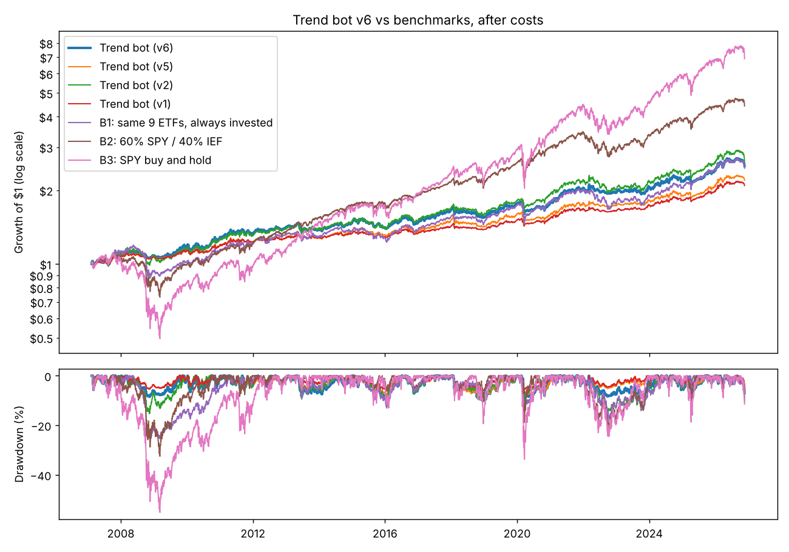

# Backtest results, spec version 6

Run on 2026-11-23 12:46 ET with Yahoo Finance data downloaded at run time. Simulation from 2007-02-12 to 2026-11-20, starting at $100,000. Trades fill at the next day's open with a 5 bp cost; cash earns the 13-week T-bill rate.

**Result: FAIL** on the three bars set in SPEC.md before this run.

| Bar | Result |
| --- | --- |
| Sharpe ratio beats B1 | 0.46 vs 0.38: yes |
| Max drawdown smaller than B1 | -11.3% vs -26.8%: yes |
| Deflated Sharpe ratio at least 0.95 | 0.939 (11 trials): no |

Counting all 11 trials, version 1's deflated Sharpe ratio is now 0.939.

Counting all 11 trials, version 2's deflated Sharpe ratio is now 0.934.

Counting all 11 trials, version 3's deflated Sharpe ratio is now 0.858.

Counting all 11 trials, version 4's deflated Sharpe ratio is now 0.815.

Counting all 11 trials, version 5's deflated Sharpe ratio is now 0.928.

## Full period

| Portfolio | Annual return | Annual volatility | Sharpe (vs T-bills) | Max drawdown | Worst calendar year | Turnover per year | Average invested |
| --- | --- | --- | --- | --- | --- | --- | --- |
| Trend bot (v6) | 4.8% | 7.4% | 0.46 | -11.3% | -6.4% (2018) | 803% | 81% |
| Trend bot (v5) | 4.1% | 5.9% | 0.44 | -9.5% | -5.4% (2018) | 648% | 66% |
| Trend bot (v2) | 5.0% | 8.1% | 0.45 | -15.5% | -8.8% (2022) | 925% | 89% |
| Trend bot (v1) | 3.8% | 5.1% | 0.46 | -7.2% | -2.9% (2015) | 539% | 56% |
| B1: same 9 ETFs, always invested | 4.7% | 8.9% | 0.38 | -26.8% | -16.6% (2008) | 24% | 90% |
| B2: 60% SPY / 40% IEF | 7.8% | 11.0% | 0.60 | -32.5% | -17.9% (2008) | 23% | 100% |
| B3: SPY buy and hold | 10.3% | 19.6% | 0.52 | -55.2% | -36.8% (2008) | 2% | 100% |

First and last calendar years are partial (2007 starts in February, 2026 ends in November).

## Sub-periods

| Period | Portfolio | Annual return | Sharpe | Max drawdown |
| --- | --- | --- | --- | --- |
| 2007-2012 | Trend bot (v6) | 6.0% | 0.64 | -8.5% |
| 2007-2012 | Trend bot (v5) | 4.3% | 0.55 | -5.8% |
| 2007-2012 | Trend bot (v2) | 5.8% | 0.60 | -15.4% |
| 2007-2012 | Trend bot (v1) | 4.2% | 0.58 | -5.4% |
| 2007-2012 | B1: same 9 ETFs, always invested | 4.8% | 0.42 | -26.8% |
| 2007-2012 | B2: 60% SPY / 40% IEF | 5.1% | 0.37 | -32.5% |
| 2007-2012 | B3: SPY buy and hold | 2.1% | 0.17 | -55.2% |
| 2013-2019 | Trend bot (v6) | 3.1% | 0.40 | -10.2% |
| 2013-2019 | Trend bot (v5) | 3.1% | 0.44 | -9.4% |
| 2013-2019 | Trend bot (v2) | 3.7% | 0.44 | -10.2% |
| 2013-2019 | Trend bot (v1) | 2.3% | 0.40 | -6.0% |
| 2013-2019 | B1: same 9 ETFs, always invested | 3.9% | 0.49 | -13.1% |
| 2013-2019 | B2: 60% SPY / 40% IEF | 9.6% | 1.21 | -10.5% |
| 2013-2019 | B3: SPY buy and hold | 14.2% | 1.04 | -19.3% |
| 2020-2026 | Trend bot (v6) | 5.2% | 0.33 | -11.3% |
| 2020-2026 | Trend bot (v5) | 4.7% | 0.31 | -9.5% |
| 2020-2026 | Trend bot (v2) | 5.4% | 0.31 | -15.5% |
| 2020-2026 | Trend bot (v1) | 4.8% | 0.37 | -7.2% |
| 2020-2026 | B1: same 9 ETFs, always invested | 5.1% | 0.27 | -17.8% |
| 2020-2026 | B2: 60% SPY / 40% IEF | 8.0% | 0.46 | -21.2% |
| 2020-2026 | B3: SPY buy and hold | 13.1% | 0.57 | -33.7% |

## Expectancy per trade

A trade is one stretch from opening a position in an ETF to fully exiting it, including resizes in between. Results are a share of total portfolio equity at entry.

| Closed trades | Win rate | Average win | Average loss | Expectancy per trade | Still open |
| --- | --- | --- | --- | --- | --- |
| 335 | 28.1% | 1.39% | -0.22% | 0.236% | 5 |

## Trials

The deflated Sharpe ratio counts all 11 trials below. Given their spread, the best of 11 unskilled trials would be expected to reach an annual Sharpe ratio of about 0.11 by luck.

| # | Trial | Annual return | Sharpe | Max drawdown |
| --- | --- | --- | --- | --- |
| 1 | Spec v1 as written | 3.8% | 0.46 | -7.2% |
| 2 | Shorter lookbacks | 3.7% | 0.44 | -8.1% |
| 3 | Longer lookbacks | 3.4% | 0.38 | -8.5% |
| 4 | 63-day volatility window | 3.9% | 0.47 | -6.7% |
| 5 | 0% hurdle | 3.9% | 0.46 | -7.9% |
| 6 | Inverse-volatility weights | 3.8% | 0.55 | -6.4% |
| 7 | Spec v2: 10% volatility as a target | 5.0% | 0.45 | -15.5% |
| 8 | Spec v3: 13 ETFs | 4.0% | 0.35 | -15.2% |
| 9 | Spec v4: v3 at 1.5x through 2x funds | 4.4% | 0.31 | -20.9% |
| 10 | Spec v5: weak scores keep positions small | 4.1% | 0.44 | -9.5% |
| 11 | Spec v6: v5 at a 15% volatility target | 4.8% | 0.46 | -11.3% |

## Cost sensitivity (version 6)

| Cost per dollar traded | Annual return | Sharpe |
| --- | --- | --- |
| 5 bp | 4.8% | 0.46 |
| 10 bp | 4.4% | 0.41 |
| 20 bp | 3.5% | 0.30 |

## Expected range for the live run

Over every 60-trading-day window in the backtest, the bot's return ran from -3.9% (5th percentile) to 6.0% (95th percentile), with a median of 1.4%. 67% of those windows ended positive. The live paper run is judged against this band.
